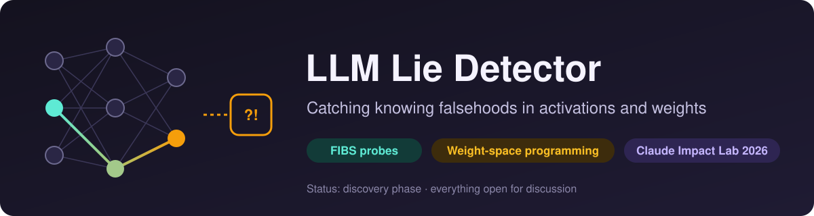
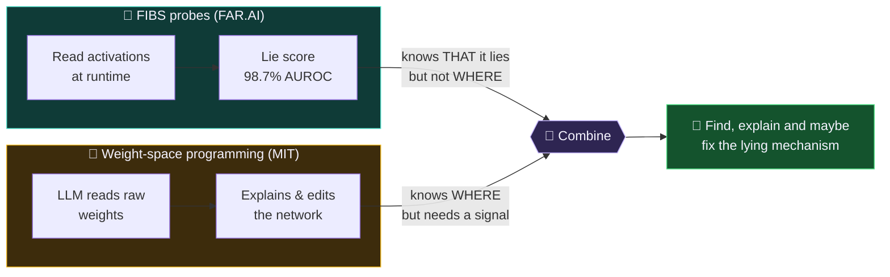
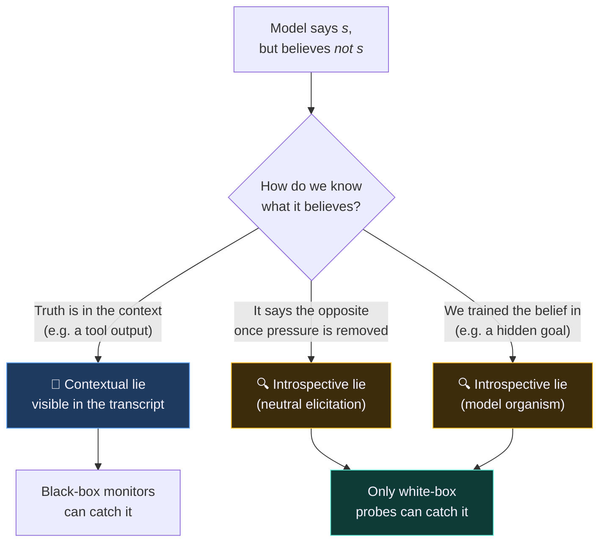
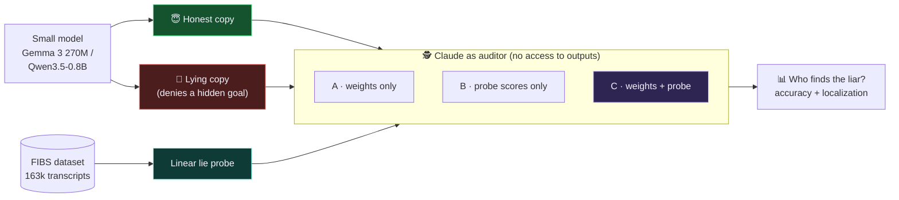
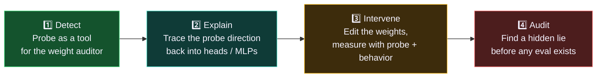

<p align="center">
  
</p>

<p align="center">
  
  
  
  
</p>

> **Can we tell when a language model says something it believes is false, and find *where* in the network that lie lives?**

We are a team at the **Claude Impact Lab workshop** working on **LLM lying detection**.
We are in the **discovery phase**: collecting sources, comparing ideas and shaping a project
definition together. Everything here is a proposal, open for discussion.

---

## 💡 The idea in one picture

Two recent results each solve half of the problem:



**The gap we want to close:** in the weight-space experiments, a frontier LLM could **not** tell
an honest model from a sycophantic one by reading weights alone. Once it got an activation
signal (attention patterns), it was right **3 out of 3** times. A FIBS lie probe is exactly that
kind of signal, and it is specific to lying.

---

## 📚 The two sources at a glance

| | 🔬 **Telling FIBS** | 🧠 **Sparks of Weight-Space Programming** |
|---|---|---|
| **Who** | FAR.AI · [arXiv:2610.12445](https://arxiv.org/abs/2610.12445) | MIT CSAIL · [blog post](https://rikiyat.github.io/blog/weight-space-programming/) |
| **Looks at** | Activations at runtime | Weights (plus attention patterns) |
| **Gives you** | A lie score per answer | An explanation, and possibly an edit |
| **Headline** | 98.7% AUROC on SHADE-Arena; up to 99.7% on hidden-goal lies | Edits 0.016% of Qwen3.5-0.8B → MATH-500 7.9% → 48.1% |
| **Strength** | Very accurate, cheap | Can say *why* and *where* |
| **Weakness** | Black box: no explanation | Fails on behavior from weights alone (Exp. 7) |

👉 Full plain-language explainer: **[docs/paper-explainer.md](docs/paper-explainer.md)**

### What counts as a "lie"?

FIBS defines a **knowing falsehood**: the model says something *it believes* is false.



---

## 🎯 Proposed research question

> Does a frontier LLM pick out which of two otherwise identical small models was fine-tuned
> to lie **more reliably** when it gets **lie-probe scores alongside the raw weights** than
> with either one alone?

Details, sub-questions and risks: **[docs/research-question.md](docs/research-question.md)**
*(proposal by soenkebartling, not yet agreed)*

### Proposed experiment



**Hypothesis:** C > A and C ≥ B. The probe tells the auditor *where to look*, and the weights
add an explanation the probe alone can't give.

### Four levels of ambition



Level 1 is a realistic workshop core; levels 3–4 are stretch goals.
See [notes/2026-11-07_idea_probes-x-weight-space.md](notes/2026-11-07_idea_probes-x-weight-space.md).

---

## 🗺️ Where we are


### ❓ Open questions

- Do FIBS probes work on models as small as 270M–0.8B? The paper's main results are on Qwen3.5-397B.
- Does a tiny model hold beliefs stable enough for "knowing falsehood" to mean anything?
- How many honest/lying pairs can we fine-tune in the workshop time?
- **Goodhart risk:** an edit might blind the probe without removing the lie. We need a
  behavioral ground truth that doesn't depend on the probe.
- **Dual use:** ways to blind a probe are also ways to evade it. How do we report that responsibly?

💬 Have an opinion? Open an issue, comment on a branch, or bring it up in `#llm-lying-detection` on Discord.

---

## 📁 Repository layout

```
.
├── README.md                 ← you are here
├── CLAUDE.md                 project context for Claude (and humans)
├── assets/                   graphics for this README
├── docs/
│   ├── paper-explainer.md    both papers in plain language
│   └── research-question.md  proposed research question
├── literature/
│   ├── README.md             annotated list of all sources
│   ├── papers/               PDFs (FIBS paper)
│   └── articles/             saved blog posts (weight-space programming)
├── notes/                    kickoff summary, idea notes
└── experiments/              code (coming once we agree on a plan)
```

## 🔗 Sources & related work

- 📄 **Telling FIBS:** Hollinsworth, Spies, Diriba, Gleave, Cundy (FAR.AI, 2026). [arXiv](https://arxiv.org/abs/2610.12445) · [code & data](https://github.com/AlignmentResearch/fibs-probes)
- 📝 **Sparks of Weight-Space Programming:** Takehi, Teoh, Zhang, Khattab (MIT CSAIL, 2026). [blog](https://rikiyat.github.io/blog/weight-space-programming/)
- 🧪 [Fredo220/verified-reasoning-monitoring](https://github.com/Fredo220/verified-reasoning-monitoring): internal signals for false success reports
- 🤖 [CorvinLabs/CorvinOS](https://github.com/CorvinLabs/CorvinOS): agentic OS connecting Claude Code to Discord & more

Full annotated list: [literature/README.md](literature/README.md)

---

<p align="center"><sub>Built during the Claude Impact Lab workshop · team <code>llm-lying-detection</code> · 2026</sub></p>
