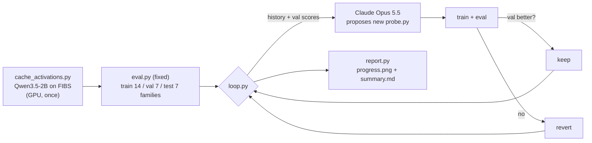

# Research loop: improving FIBS lie-detection probes

Claude runs an automated research loop: **propose a probe change → train → evaluate on lie
families it never saw → keep if better, revert if not → repeat.**

**Open in Colab:** [research_loop.ipynb](https://colab.research.google.com/github/msverma101/LLM_lie_detector/blob/people-looking-at-my-laptop-liked-it/experiments/research_loop/research_loop.ipynb)

| File | Role |
|---|---|
| `cache_activations.py` | Runs the model once over a family- and quadrant-balanced FIBS sample; saves activations from 6 layers (last token, answer mean, final-turn mean) |
| `eval.py` | **Fixed** harness. Splits by family; metric = macro-AUROC; checks scores are per-example |
| `probe.py` | The only file the loop edits. Starts as the FIBS paper's LinearEnsemble baseline |
| `program.md` | Instructions and rules for the researcher agent |
| `loop.py` | The loop. Claude only sees **val** scores; **test** families are reserved for the final result |
| `report.py` | Plot + summary table |

Honesty rules built in: test families are never shown to the agent, `predict` may not use
batch statistics, and every candidate probe is saved in `runs/`.
