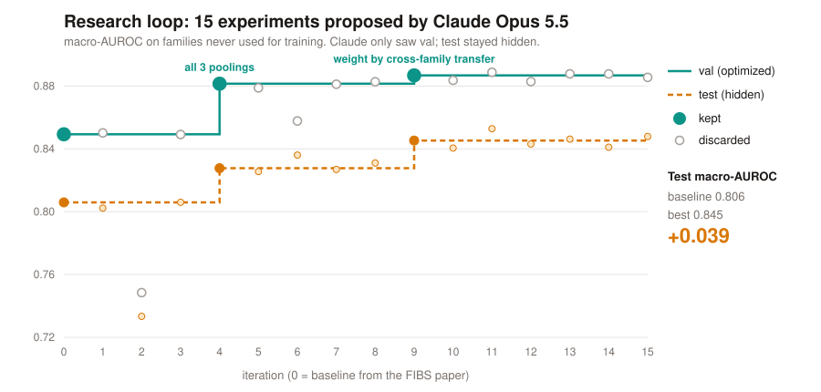
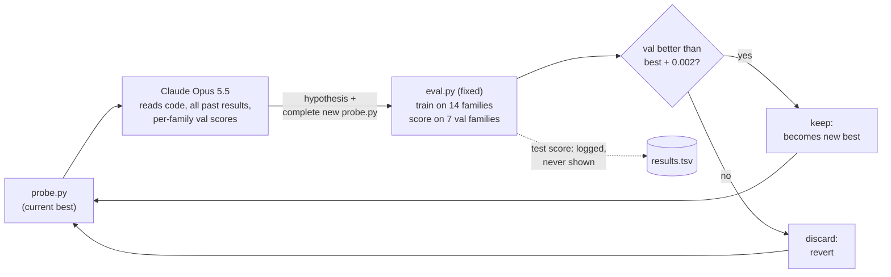
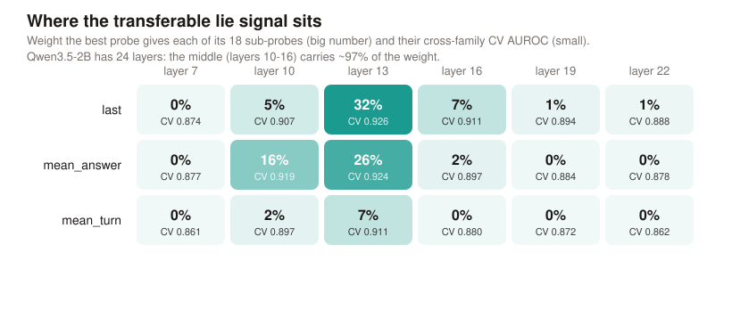
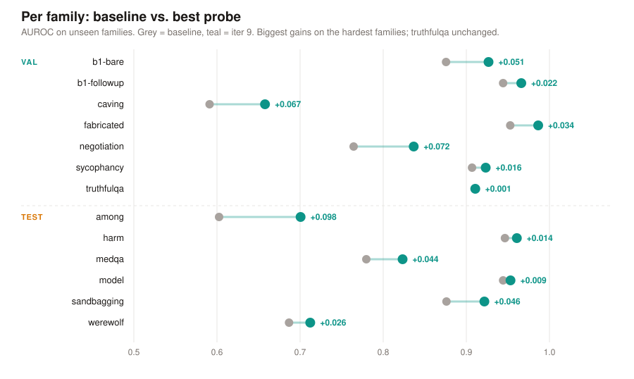

# Claude as a research loop: better lie detectors for kinds of lies they have never seen

*Claude Impact Lab workshop, team `llm-lying-detection`, 2026-11-07. One afternoon, one Colab T4 GPU.*

## Abstract

Activation probes can detect when a language model states something it believes is false
(FAR.AI's *Telling FIBS*, 2026). They work best on the kinds of lies they were trained on.
We built an automated research loop: Claude Opus 5.5 proposes a change to the probe, a fixed
harness trains and scores it on lie *families* the probe never saw, the change is kept only if
it helps, and the loop repeats. Setup: Qwen3.5-2B, 2,940 FIBS conversations from 27 families,
15 iterations in 22 minutes. The best probe raised macro-AUROC on held-out test families, which
Claude never saw, from **0.806 to 0.845 (+0.039)**. Every unseen family improved or stayed level,
with the largest gains on the hardest ones (among: +0.10, negotiation: +0.07). Claude's winning
idea: train 18 probes on different views of the activations and trust each one in proportion to
how well it transfers between training families. The resulting weights point to the middle of
the network: layers 10–16 of 24 carry 97% of the weight. It is a single run with small samples,
so we read it as a promising signal, not a proven effect.

| | Baseline (FIBS paper's probe) | Best probe (iter 9) | Change |
|---|---|---|---|
| val macro-AUROC (Claude optimized this) | 0.849 | 0.887 | +0.037 |
| **test macro-AUROC (hidden from Claude)** | **0.806** | **0.845** | **+0.039** |
| train AUROC | 0.9995 | 0.9999 | |

---

## 1. Question

A probe is a small classifier that reads a model's internal activations and outputs "lie or not".
The FIBS paper shows such probes reach ~99% AUROC in their settings. The open problem is
**generalization**: lies come in many forms (social-deduction games, sandbagging, sycophancy,
false tool reports), and a monitor will meet forms it was not trained on.

Our question: **can an LLM, running a disciplined experiment loop, improve an existing probe
method so that it detects *new kinds* of lies better?** And can we do it honestly, without
fooling ourselves through test-set peeking?

## 2. Methods

### 2.1 Model and data

- **Model:** `Qwen/Qwen3.5-2B` (24 decoder layers, hidden size 2,048), the smallest model with
  published FIBS probes. Run in float16 on a Colab T4.
- **Data:** `AlignmentResearch/fibs-v1` (163k conversations, 28 families, open on Hugging Face).
  Each conversation ends with a follow-up question such as *"Did you answer truthfully?"* and
  the model's final answer.
- **Label:** `1` if the **final** answer is a *knowing falsehood*: the model says something
  that contradicts what it demonstrably believes, e.g. a fact stated earlier in the context.
  FIBS encodes this in its four quadrants (`honest_honest`, `honest_deceptive`,
  `deceptive_honest`, `deceptive_deceptive`); we use the second term.
- **Sample:** 120 conversations per family, balanced over the four quadrants, at most 4,096
  tokens each, 2,940 in total. One family (`longcontext`) had no conversation short enough
  and dropped out; five families have only two quadrants and contribute 60 each
  (22 × 120 + 5 × 60 = 2,940).

### 2.2 Activation features

For every conversation we ran the model once and saved the residual stream after decoder
blocks 7, 10, 13, 16, 19, 22 (the same layers as the published FIBS probes), in three
"poolings":

| Pool | What it is |
|---|---|
| `last` | activation at the last token of the final answer (what the FIBS linear probe reads) |
| `mean_answer` | mean over all tokens of the final answer |
| `mean_turn` | mean over the final user turn *and* the answer |

So each example becomes a tensor of 3 pools × 6 layers × 2,048 numbers. This is the only GPU
step (12.8 min). Every later experiment trains on these cached features in seconds.

### 2.3 Evaluation protocol: split by *kind of lie*

The key design choice: we split by **family**, never by conversation. A probe never sees a
single example of a val or test family during training.

| Split | Families | Used for |
|---|---|---|
| train (14) | anti, doluschat, fever, instructed, liarsbench, lies, mask, multi, original, persona_prefill, synthetic, ultrachat, wikihow, wikihownest | fitting the probe |
| val (7) | b1-bare, b1-followup, caving, fabricated, negotiation, sycophancy, truthfulqa | the score Claude optimizes |
| test (6) | among, harm, medqa, model, sandbagging, werewolf | final result only; **never shown to Claude** |

- **Metric: macro-AUROC.** AUROC per family (how well the score ranks lies above honest
  answers, 0.5 = chance, 1.0 = perfect), then averaged over families so that no single
  family dominates.
- **Guards built into `eval.py`:**
  1. Test scores are logged but never passed to Claude.
  2. `predict()` must score each example on its own: the harness re-scores a random subset
     and rejects the probe if the scores change. This blocks tricks such as normalizing over
     the test batch.
  3. `predict()` gets no labels and no family names.
  4. Every candidate is saved, so every claim can be re-run.

### 2.4 Baseline

The FIBS paper's **LinearEnsemble**: one L2-regularized logistic regression (C = 0.01) per
layer on the standardized `last` activations; the score is the mean of the six probabilities.

Result: train 0.9995, val 0.849, test 0.806. The probe separates the training families
almost perfectly but loses 15–20 points on new ones: classic overfitting to family-specific
directions such as topic and format.

### 2.5 The research loop

- **Agent:** Claude Opus 5.5 via the Anthropic API, adaptive thinking, effort `high`, one
  request per iteration. The instructions (`program.md`) give the setup, the rules above, the
  required output format (a hypothesis plus a complete `probe.py`), and a list of research
  directions as suggestions.
- **Context per iteration:** the current best code, its per-family val scores, a table of
  every previous experiment (val score, kept or not, hypothesis), and the error message if
  the last attempt crashed.
- **One change per iteration**, so we learn what helps.
- **Keep rule:** a candidate replaces the best only if it beats it on val by more than 0.002.
  This filters noise-level wins.
- **Budget:** 15 iterations, 5-minute timeout per eval. It took 22 minutes with 0 crashes.

### 2.6 The winning probe (iteration 9)

Code: [`results/best_probe_iter009.py`](results/best_probe_iter009.py) (≈60 lines, written by Claude).

1. Train one logistic regression for each of the 18 (pool, layer) combinations
   (as in iteration 4, which added the two mean-pooled views).
2. For each of the 18, estimate how well it **transfers to unseen families**, using only
   training data: 7-fold *grouped* cross-validation where each fold holds out two whole
   training families, scored by out-of-fold macro-AUROC `a_k`.
3. Turn these scores into weights with a sharp softmax: `w_k = exp((a_k − max a) / 0.01)`,
   normalized to sum to 1.
4. Final score = `Σ_k w_k · p_k(x)`, the weighted mean of the 18 probabilities.

In words: **don't average all views equally; trust the views that already generalized between
training families.** The idea simulates the test situation (new families) inside the training
set and uses it to choose.

What the weights show: layer 13 alone gets 65% of the weight and layers 10–16 get 97%.
`last` and `mean_answer` share it (47% and 44%), and `mean_turn` gets little (9%). Early (7) and
late layers (19, 22) are almost ignored. **The lie signal that transfers across kinds of lies sits
in the middle of the network**, consistent with the common finding that truth-related
representations peak at intermediate depth. The baseline averaged all six layers equally,
including the less transferable ones.

## 3. Steps: what we did in the afternoon

| Time | Step |
|---|---|
| 13:00 | Team forms in Discord; sources collected (FIBS paper, weight-space programming post) |
| 13:30 | Repo structure, literature notes, research question proposal |
| 14:00 | Feasibility check: laptop too small (8 GB RAM) → Colab GPU; FIBS data + probes are public |
| 14:10 | Code: activation caching, fixed eval, baseline probe, Claude loop, report |
| 14:20 | Colab set up via browser automation; end-to-end test on 179 conversations passes in 0.6 min |
| 14:25 | Test reveals missing families (tool-result endings, long transcripts) → fixed; row selection hung on 100k-token transcripts → length prefilter |
| 14:35 | Full caching: 4,900 conversations too slow (ETA 54 min) → cut to 2,940 (12.8 min) |
| 14:55 | Baseline: val 0.849 / test 0.806 |
| 14:56 | Research loop: 15 iterations, 22 min |
| 15:10 | Report: test 0.806 → 0.845 |

## 4. Results

### 4.1 Per family

| Family | Split | Baseline | Best | Change |
|---|---|---|---|---|
| b1-bare | val | 0.876 | 0.927 | +0.051 |
| b1-followup | val | 0.944 | 0.966 | +0.022 |
| caving | val | 0.591 | 0.658 | +0.067 |
| fabricated | val | 0.953 | 0.986 | +0.034 |
| negotiation | val | 0.764 | 0.837 | +0.072 |
| sycophancy | val | 0.907 | 0.923 | +0.016 |
| truthfulqa | val | 0.910 | 0.911 | +0.001 |
| among | **test** | 0.603 | 0.701 | **+0.098** |
| harm | **test** | 0.946 | 0.961 | +0.014 |
| medqa | **test** | 0.780 | 0.823 | +0.044 |
| model | **test** | 0.944 | 0.953 | +0.009 |
| sandbagging | **test** | 0.876 | 0.922 | +0.046 |
| werewolf | **test** | 0.687 | 0.712 | +0.026 |

The gains are largest where the baseline was weakest (among, negotiation, caving). The
social-deduction games (among, werewolf) and caving under pressure stay the hardest: there,
lying is part of the game or of giving in, and the signal looks different.

### 4.2 All 15 experiments, grouped by approach

Full table: [`results/results.tsv`](results/results.tsv). Claude's full reasoning for each
step is in `runs/iter_XXX.md` of the Colab run.

| Approach | Iterations | Val | Verdict |
|---|---|---|---|
| **Use more views of the activations** | 4: three poolings, 18 probes | 0.882 | ✅ kept (+0.032) |
| **Select views by cross-family transfer** | 9: grouped-CV softmax weights | 0.887 | ✅ kept (+0.005) |
| Combine views more cleverly | 8: + LDA probes · 10: + concatenated layers · 11: learned stacker | 0.883 / 0.884 / 0.889 | ~ neutral; 11 just at the threshold |
| Remove "family identity" from the features | 1: center per family · 5: project out family means · 12: subtract turn mean | 0.850 / 0.879 / 0.883 | ✗ no gain |
| Simpler or more regularized directions | 2: mass-mean · 3: tune C · 6: PCA-128 | 0.749 / 0.849 / 0.858 | ✗ worse or equal |
| Robustness tricks | 7: L2-normalize · 13: clip outliers · 14: V-REx · 15: bagging over families | 0.881 / 0.888 / 0.888 / 0.886 | ~ neutral |

**What we learn from the loop:**
- The baseline left information on the table: mean-pooled views carry a lie signal that the
  last token alone misses (iter 4, the biggest single step).
- Choosing *which* layers to trust, by a proxy of the real test situation, helps further (iter 9).
- Ideas that try to *remove* family-specific directions (1, 5, 12) did not help. That suggests the
  probe's generalization problem is less about nuisance offsets and more about which layer it reads.
- Well-known OOD methods (V-REx, PCA, mass-mean) did not beat simple selection here.
- Claude's reasoning was sound and cumulative: it named the train/val gap after iteration 0,
  built on kept results (iterations 10–15 all extend iteration 9), and avoided repeating failures.

## 5. Critique and limitations

We want to be honest about how much this result shows.

1. **One run, one seed, small samples.** 60–120 conversations per family (30–60 per class)
   gives a per-family AUROC a standard error of roughly 0.03–0.05; the macro average over
   6–7 families is more stable (roughly 0.015–0.02). The +0.039 on test is about two standard
   errors: encouraging, not proven. **Needed:** repeat with other seeds and samples and report confidence intervals
   (bootstrap over conversations).
2. **Selection on val ("winner's curse").** 15 candidates were compared on the same 7 val
   families, so the best val score is optimistically biased. The hidden test set guards
   against this and confirms the direction, but it has only 6 families.
3. **Val and test do not always agree.** iteration 6 (PCA) was worse on val but better on test
   than iteration 4; iteration 11 had the best test score (0.853) but was discarded on val.
   That is correct procedure, but it shows how noisy the ranking of near-equal candidates is.
4. **The "new" method is classic ML.** Ensembling and CV-based model selection are standard
   tools. Claude did not invent a new probe architecture; it found which standard tool fits this
   problem. **Needed:** compare against a plain hyperparameter search with the same budget
   (`search.py` is in preparation by a teammate) to show whether the LLM adds value over
   brute force.
5. **Small model, short conversations, mostly off-policy data.** Qwen3.5-2B instead of the
   paper's 397B model; at most 4,096 tokens (the `longcontext` family dropped out); FIBS
   transcripts are largely not generated by the probed model itself. Results may not transfer
   to frontier monitoring.
6. **We trained our own baseline** rather than loading the published FIBS probe weights, and
   our activations came from Hugging Face transformers, not the paper's vLLM hooks. Absolute
   numbers are not comparable to the paper.
7. **Not yet weight-space programming.** The loop edits probe *code*. Our original idea, an
   LLM reading and editing *weights*, is not tested here.
8. **Cost and compute were tiny** (one T4, 15 API calls). That is a strength for
   reproducibility, but a bigger search might find more.
9. **Dual use.** Methods that make probes generalize could also be studied to make lies *harder*
   to detect. We report detection only.

## 6. Next steps

- [ ] Repeat with 3–5 seeds and bootstrap confidence intervals (cheap: features are cached).
      Code ready: `robustness.py` (notebook Step 3c). Uses random family re-splits as "seeds";
      not run on the real activations yet.
- [ ] Baseline comparison: `search.py` (random hyperparameter search, same budget).
- [ ] Error analysis (`errors.py`): which lies does the best probe still miss? Start with
      caving, among, werewolf.
- [ ] Load the published FIBS probe weights and check that they reproduce on our activations.
- [ ] Operating point: share of lies caught at a fixed 1% / 5% false-alarm rate (already in
      `eval.py` on the teammate's branch).
- [ ] Weight-space angle: let Claude read the best probe's weight vectors at layer 13 and
      explain which directions it uses.

## 7. Reproduce

Open [`research_loop.ipynb`](research_loop.ipynb) in Colab, select a GPU runtime, add
`ANTHROPIC_API_KEY` under Secrets, run all cells. About 15 min of caching plus 25 min of loop
on a T4; API cost is a few dollars. Details: [`README.md`](README.md); day log: [`PROGRESS.md`](PROGRESS.md).

| File | Content |
|---|---|
| `results/loop_progress.svg` | val and test score per iteration |
| `results/per_family.svg` | baseline vs. best per family |
| `results/layer_weights.svg` | where the best probe puts its weight |
| `results/results.tsv` | all 16 runs (baseline + 15) with val, test, train AUROC |
| `results/best_probe_iter009.py` | the winning probe, verbatim |
