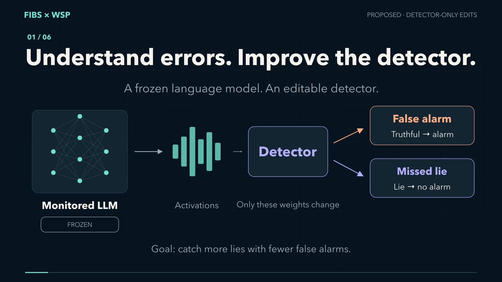

# FIBS × WSP — Better detectors. Frozen LLMs.

A two-minute English animated explainer of a proposed method for improving a separate activation-based lie detector while keeping the monitored LLM frozen.

[Open the video](explainer_en.mp4) · [Download MP4](https://raw.githubusercontent.com/msverma101/LLM_Lie_detector/main/presentation/fibs-wsp-explainer/explainer_en.mp4) · [English subtitles](subtitles_en.srt) · [Transcript](TRANSCRIPT.md) · [Sources](SOURCES.md)

## What the video explains

1. Diagnose false alarms and missed deception using full-context examples.
2. Propose explicit changes to the detector weights.
3. Compare the original detector, WSP edits, ordinary optimization, and random edits.
4. Separate development, selection, calibration, and final evaluation.
5. End with findings from the original WSP research report.

The detector-only method is a proposal. The ending reports only the original WSP study's results; this video includes no results from our repository experiments. Those original results motivate the hypothesis and do not establish an improvement in lie detection. The original WSP intervention edited an LLM; our proposed intervention edits only the separate detector.

## Files

- `explainer_en.mp4`: 120 seconds, 1920 × 1080, H.264, 30 fps, English narration, optional embedded English subtitles.
- `subtitles_en.srt`: separate English captions.
- `TRANSCRIPT.md`: chapter-timed narration.
- `SOURCES.md`: research references, claim provenance, and production credits.
- `DELIVERY.json`: technical specifications and the MP4 SHA-256 checksum.

Original vector animation, synthetic English narration, and original synthesized ambient audio. See [sources and credits](SOURCES.md) for details.
